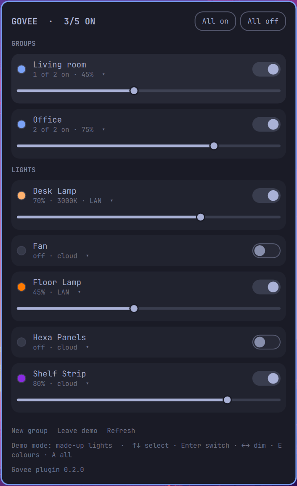
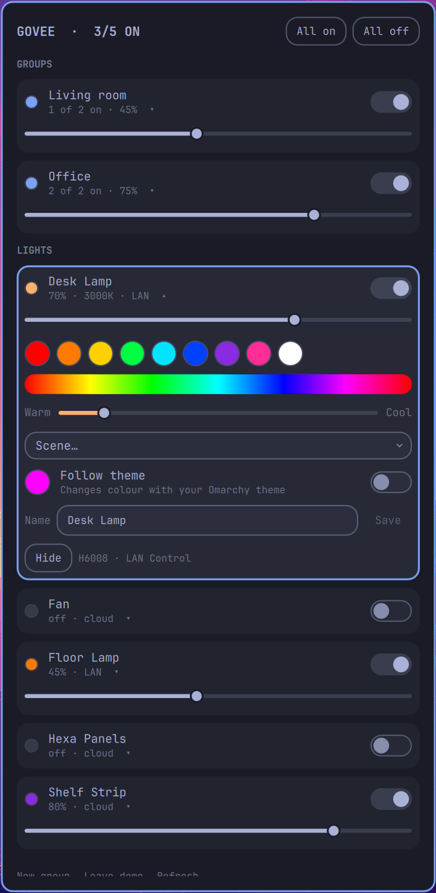
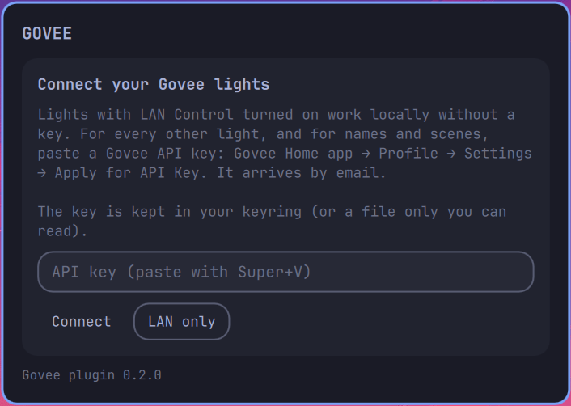

# Govee Lights for Omarchy

Your Govee lights in the Omarchy bar: switch them on and off, set brightness,
colour and white temperature, apply Govee's scenes, control rooms of lights
as groups, and let them take your Omarchy theme's colour. Lights with LAN Control are driven over your local network,
instantly and without the cloud. Everything else goes through the official
Govee cloud API. Setup happens in the panel, and the API key stays out of the
shell.

In the bar it is a single bulb. It lights up, in your theme's accent colour,
while any light is on.

Version 0.2.0 · [Changelog](CHANGELOG.md) · MIT licensed · by ELD Technologies

> **Unofficial.** This is an independent community plugin. It is not made,
> endorsed, or supported by Govee or by the Omarchy project.

## Screenshots

| Lights and groups | Colour, white and scenes |
|---|---|
|  |  |



*The lights in these screenshots are made up, from the plugin's demo mode
(see [Trying it without lights](#trying-it-without-lights)). The screenshots
themselves are of the real plugin.*

## Requirements

- Omarchy with the Quickshell-based Omarchy shell
- Govee Wi-Fi lights, plugs or strips
- `python3` (ships with Omarchy; the helper uses only the standard library)
- `secret-tool` from `libsecret` and a keyring such as `gnome-keyring` (both
  ship with Omarchy) to keep the API key in the keyring; optional
- For the cloud: a Govee API key (free, see below). For LAN control:
  LAN Control turned on for each light, and the firewall rule below

## Install

```bash
omarchy plugin add https://github.com/eldtechnologies/omarchy-plugin-govee --enable
```

Or install from a checkout. This also puts the `eld-govee` command on your
`PATH`:

```bash
git clone https://github.com/eldtechnologies/omarchy-plugin-govee
cd omarchy-plugin-govee
./install.sh            # or ./install.sh --link while developing
```

Then click the bulb in the bar.

### Connecting your lights

The panel asks for a **Govee API key**. To get one, open the Govee Home app,
go to **Profile → Settings (gear) → Apply for API Key**, and fill in the
short form. The key arrives by email within a few minutes. Paste it with
Super+V and press **Connect**. The plugin checks the key with Govee, then
stores it in your keyring.

No key? Choose **LAN only**. You then get only lights with LAN Control, and
no scenes. Over the LAN a light only reports its model number, so it shows
up as something like `H6072 6452`, with "click to rename" underneath. Click
its name and give it a real one (see [Renaming lights](#renaming-lights)).
You can add a key later with **Add API key** at the bottom of the panel.

From a terminal: `eld-govee setup`.

### LAN control

Local control is faster (no round trip to Govee), works when the internet is
down, and costs nothing from the cloud quota. Two things are needed:

1. **Turn on LAN Control** for each light: Govee Home app → the light →
   settings (gear) → LAN Control. Not every model has it.
2. **Let the replies through your firewall.** Omarchy's `ufw` drops incoming
   traffic by default, and Govee lights answer on UDP port 4002, so discovery
   finds nothing. The panel spots this and shows the exact command to run.
   It looks like this:

   ```bash
   sudo ufw allow from 192.168.1.0/24 to any port 4002 proto udp comment 'Govee LAN'
   ```

   The rule only admits your own subnet, on that one port.

`eld-govee doctor` checks both.

Lights on the LAN are matched to their cloud entries automatically, so they
keep their names and scenes. If a light stops answering on the LAN, commands
fall back to the cloud.

## Using it

### Bar and panel

- **Click** the bulb for the panel. **Middle-click** switches every light
  (toggle, or all off, see settings). **Right-click** refreshes. **Scroll**
  dims or brightens the lights that are on.
- Each light has a switch, a brightness slider while it is on, and a dot in
  its current colour. **Click its name** for colour swatches, a hue strip, a
  warm-to-cool white slider, scenes, Follow theme, its name, and Hide.
- **All on / All off** in the header.
- Keyboard: ↑/↓ select, Enter switches, ←/→ dims or brightens by 10%,
  E opens colours, A switches everything, R refreshes, Esc closes.

### Renaming lights

Click a light's name, type a new one in the **Name** field, and press Enter
or **Save**. Clear the field and save to go back to the original name. The
name works everywhere: in the panel, in groups and on the command line
(`eld-govee on "Floor lamp"`). It is stored locally, in
`~/.config/eld-govee/config.json`, and takes priority over the name in the
Govee app; Govee itself is never changed.

### Theme colours

Open a light or a group and turn on **Follow theme**. From then on, when you
change your Omarchy theme, it takes the theme's colour. The dot next to the
switch shows that colour; click it to use it once without following.


- The colour is the one Omarchy gives RGB keyboards (`keyboard.rgb` in the
  theme): the theme's accent, unless the theme picks its own. It is used at
  full strength, and your brightness stays as it is.
- Only lights that are on change. A theme change never turns a light on.
- It works through an Omarchy hook,
  `~/.config/omarchy/hooks/theme-set.d/eld-govee`, which the plugin adds
  while anything follows the theme and removes when nothing does.

From a terminal:

```bash
eld-govee theme follow Office         # a light, a group, or all
eld-govee theme unfollow all
eld-govee theme                       # the theme's colour, and what follows it
eld-govee color "Desk Lamp" theme     # the theme's colour, once
```

### Groups

**New group** at the bottom of the panel: give it a name (Office, Living
room) and pick its lights. A group has its own switch, brightness, colour,
white and scenes, and appears first in the panel. Click a group's name, then
**Edit group** to change or delete it.

From a terminal:

```bash
eld-govee group set Office "Desk Lamp" "Shelf Strip"
eld-govee group list
eld-govee group remove Office
```

### Keybindings and scripts

Every panel action is a command. A target is a light's name (a unique part of
it is enough), a group, a device ID, or `all`. `./install.sh` puts
`eld-govee` on your `PATH`; after `omarchy plugin add` it is at
`~/.config/omarchy/plugins/com.eldtechnologies.govee/bin/eld-govee`.

```bash
eld-govee list                         # every light and its state
eld-govee toggle                       # everything: off if any is on, else on
eld-govee on Office
eld-govee brightness "Desk" 40         # or +10 / -10
eld-govee color Office "#ff8800"       # or red, orange, ... warm, white
eld-govee temp all 2700                # kelvin
eld-govee scene "Shelf" Aurora
eld-govee scenes "Shelf"               # what scenes that light has
eld-govee rename "H6008 0011" "Desk Lamp"
eld-govee hide "Fan Plug"              # leaves the panel and 'all'
eld-govee theme follow Office          # see Theme colours
```

In `~/.config/hypr/bindings.lua`, `--notify` turns errors into desktop
notifications. These keys are free in a stock Omarchy; check yours with
`omarchy menu keybindings --print`:

```lua
o.bind("SUPER + ALT + L", "Toggle lights", "eld-govee --notify toggle")
o.bind("SUPER + CTRL + ALT + BRACKETRIGHT", "Brighter lights", "eld-govee --notify brightness all +10")
o.bind("SUPER + CTRL + ALT + BRACKETLEFT", "Dimmer lights", "eld-govee --notify brightness all -10")
```

The panel itself also answers IPC:
`omarchy-shell com.eldtechnologies.govee toggle` (also `open`, `close`,
`refresh`).

## Trying it without lights

```bash
eld-govee demo on     # five made-up lights and two groups
eld-govee demo off    # back to your own
```

Demo lights behave like real ones, LAN and cloud alike: switches, colours,
scenes, groups and names all work. Nothing goes over the network, and your
own config, groups and API key are left alone. **Leave demo** in the panel
footer turns it off.

## Configuration

Settings → Bar → Govee Lights, or in `~/.config/omarchy/shell.json`:

| Setting       | Default      | What it does |
|---------------|--------------|--------------|
| `refresh`     | `balanced`   | How often to check while the panel is closed. LAN lights are read every time (30 s fast, 60 s balanced, 5 min efficient); cloud lights only every 5, 15 or 60 minutes, to spare the quota |
| `middleClick` | `toggle-all` | `toggle-all`, `off-all`, or `nothing` |
| `scrollStep`  | `10`         | Brightness change per scroll notch on the bar icon; `0` turns scrolling off |
| `showHidden`  | `false`      | Show hidden lights in the panel, dimmed, so they can be unhidden |

The helper keeps its own files out of the shell's:

- `~/.config/eld-govee/config.json`: groups, local names, hidden lights, and
  the API key only when no keyring is available (mode 0600)
- `~/.local/state/eld-govee/state.json`: what the panel shows
- `~/.local/state/eld-govee/cache.json`: the device list, scenes, LAN
  addresses and today's cloud request count
- `~/.local/state/eld-govee/demo/`: demo mode's own config and lights, while
  it is on

## How it works

The shell runs QML only. Everything that talks to the network or touches
the key is `bin/eld-govee`, a Python script that uses only the standard
library:

- **LAN**: discovery is a multicast `scan` to 239.255.255.250:4001; lights
  answer on UDP 4002 and take commands on 4003. After each command the helper
  asks the light for its status, which confirms it heard. Commands go to the
  address the reply came from, never to an address named inside a packet.
- **Cloud**: `openapi.api.govee.com/router/api/v1` over HTTPS with normal
  certificate checks. Redirects are refused, so the key cannot be carried to
  another host.
- **State**: the helper writes `state.json` before it sends a command, so the
  panel reacts at once, then writes the confirmed result, or rolls back and
  records the error. Concurrent runs are serialized with file locks, and LAN
  work holds its own lock so two runs never compete for port 4002.

### The cloud quota

Govee allows 10,000 cloud requests per account per day. The plugin keeps
well under that:

- The device list is fetched twice a day; scenes once a week per light.
- LAN lights never use the cloud for state, and only fall back to it for
  commands when they go quiet.
- The panel queues commands, and a newer change to the same light replaces
  one still waiting. A slider drag or a wheel spin sends one request, not
  dozens.
- The panel footer shows today's count.

## Removing it

```bash
omarchy plugin remove com.eldtechnologies.govee
# or, from a checkout:
./uninstall.sh            # asks whether to delete the key and groups
./uninstall.sh --purge    # deletes them
```

Removing the key locally does not revoke it with Govee. `uninstall.sh` also
removes the theme hook; after `omarchy plugin remove`, run
`eld-govee theme unfollow all` first, or delete
`~/.config/omarchy/hooks/theme-set.d/eld-govee` (left behind, it does
nothing).

## Developing

```bash
./install.sh --link       # symlink the checkout
omarchy restart shell     # after QML edits: the shell does not watch through the symlink
python3 -m unittest discover -s tests -v
```

The tests run the real CLI against a fake Govee cloud on localhost and a
fake LAN light on loopback. They use a throwaway config directory and a fake
`secret-tool`, so they never touch your keyring, your lights or your account.

## Disclaimer

Govee is a trademark of Shenzhen Intellirocks Tech. Co., Ltd. This plugin
uses Govee's public developer API and documented LAN protocol, and is not
affiliated with or endorsed by Govee.

## License

MIT. See [LICENSE](LICENSE).
